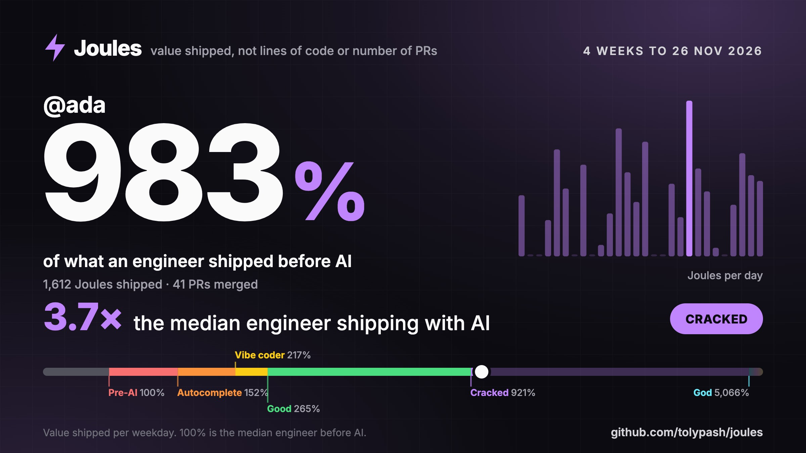
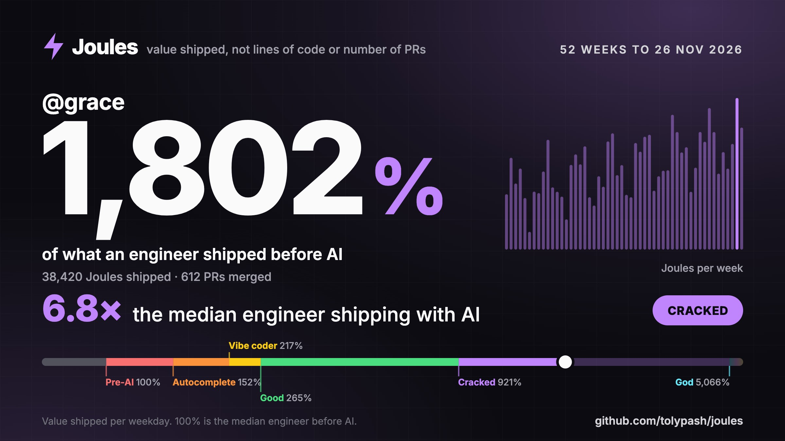

# ⚡ Joules

See the energy your team ships.



Joules gives every pull request a score for the value it delivers: what it does, who feels it and how hard it was. Not lines of code, not PR count. With AI writing thousands of lines in minutes, those numbers stopped meaning anything. A one-line fix to a payment bug can be worth more than a 5,000-line scaffold, and Joules says so.

```
⚡ 36 J · feature · customers · ~12 expert hours
Adds tips at checkout across the till, the web order page and the payment webhook.
```

## How a score is made

Claude reads the PR (title, description, linked ticket, the diff without lockfiles and generated code) and rates three things:

- **Expert hours:** how long a senior engineer who knows the codebase would have needed without AI. A typo is 0.25, a new setting end to end is 4, a new payment integration is 30.
- **Reach:** who feels it. Customers 3, the team 2, the system itself 1.5, only developers 1.
- **Kind:** feature, fix and perf 1; refactor 0.7; tests 0.6; docs and chores 0.4; dependency bumps 0.3; a revert 0.

**Joules = expert hours × reach × kind.** Every score comes with one line saying why, so anyone can see where the points came from. The rubric is [one file](skill/joules/rubric.md).

Fourteen days after merge the score settles (`joules settle`, run daily): a reverted PR drops to 0 and each follow-up fix that points back at it takes a quarter off. Value that sticks counts most.

## What you get

- **On every PR:** the agent that opens it (Claude Code, Codex, Cursor) scores it and puts the score in the description. Your team already opens PRs with an agent, so scoring needs no server and no secret.
- **On the ticket:** when the PR names a Linear or Jira issue (`ABC-123` in the branch, title or description) and the agent has a tracker tool, it posts the score there too.
- **A card to share:** `joules card` turns your week, month or year into one image, measured against the median engineer shipping with AI, on a ladder from Pre-AI to God. [See below](#share-your-joules).
- **Team view:** `joules report` gives a table per person for the last 24 hours, 7 days and the window you pick (`--days`), and with `--html` each person's highest and lowest-value PRs. Good for a weekly shout-out, a sprint review, or spotting someone who's stuck and needs a hand.

## Share your Joules

One command turns your week, month or year into a card made to be posted:

```sh
bunx joules-cli card                                             # your last 4 weeks in this repo
bunx joules-cli card --period year --repos acme/shop,acme/api    # or week; any repos you work in
```

It writes `joules-card.png` (when the machine has Chrome) and opens `joules-card.html`: the card, a Copy image button, and Post on X with the text already written. Or ask your agent to "share my Joules": the skill makes the same card with no CLI.

- **One number: your output.** Joules per weekday as a percentage of what an engineer shipped before AI (the same efficiency the team view shows), and next to it how many times the median engineer shipping with AI that is.
- **A colour-coded ladder, drawn to a log scale:** Pre-AI (100%), Autocomplete (152%), Vibe coder (217%), Good (265%, today's median), Cracked (921%, the top 10%) and God (5,066%, the highest measured). The card takes the colour of the rung you reached.
- **Numbers only.** No repo names and no PR titles, so it is safe to post from private work.
- **Week, month or year:** the last 7 days, 4 weeks or 52 weeks, each with its skyline of Joules per day or per week.




## Set it up

**In a repo** (needs [Bun](https://bun.sh)): run `bunx joules-cli init`, then commit what it adds. Claude Code gets the skill and a pre-PR hook that holds `gh pr create` until the PR has a score; other agents read the note it adds to AGENTS.md or CLAUDE.md.

**Just the skill** (no Bun or Node needed): copy [skill/joules](skill/joules) (SKILL.md, rubric.md and card.html) into `~/.claude/skills/joules/` or a repo's `.claude/skills/joules/`.

**Works on day one.** No history or setup needed: the levels are already measured.

| Joules per weekday, full-time engineers | Median | Top 10% |
|---|---:|---:|
| Before AI (71 engineers, Q4 2024) | 8.2 | 18 |
| With AI (128 engineers, Aug to Oct 2026) | 21.7 | 75.5 |

Both from the same 8 public product repos: Twenty, Novu, Formbricks, Documenso, n8n, Langfuse, Infisical and Plane.

Efficiency is Joules per weekday against the pre-AI median: 100% is the same output as before AI, good today is 265%, cracked (the top 10%) 921%. The full table, a team's own baseline and how to read it fairly are in [the skill](skill/joules/SKILL.md#whats-good-the-measured-numbers); the raw numbers in [data/](data).

**The CLI.** Needs [Bun](https://bun.sh), the [Claude Code CLI](https://docs.claude.com/claude-code) signed in, and `gh` signed in (or `GITHUB_TOKEN`).

```sh
bunx joules-cli score acme/shop#123            # one PR
bunx joules-cli backfill --repos acme/shop,acme/api --days 90
bunx joules-cli report --repos acme/shop,acme/api --days 30 --compare --html team.html
bunx joules-cli settle acme/shop --write          # run daily: reverts and follow-up fixes
bunx joules-cli stats --repos acme/shop --days 90 --html team.html   # per person: weekly Joules, typical day, rework
bunx joules-cli card --period month                # your own Joules as a card to share
```

With `--write`, `score` and `settle` post on the linked ticket when `LINEAR_API_KEY` (or `JIRA_BASE_URL`, `JIRA_EMAIL` and `JIRA_API_TOKEN`) is set.

`stats` counts over the same scores as `report` (scoring PRs not yet in the cache); the counting itself is plain code, so the same scores give the same numbers every time. Scores are kept in `joules-cache.jsonl` so nothing is scored twice. A report reads the scores agents wrote in PRs, and scores the rest.

## Good to know

- Scores are an estimate from a model reading the change. Treat a week or a month as the signal, not a single PR.
- Bots (Dependabot and friends) are scored but left out of the team table.
- Nothing leaves your GitHub except the PR text sent to Claude to score it, and the score posted on its ticket.

## License

MIT
